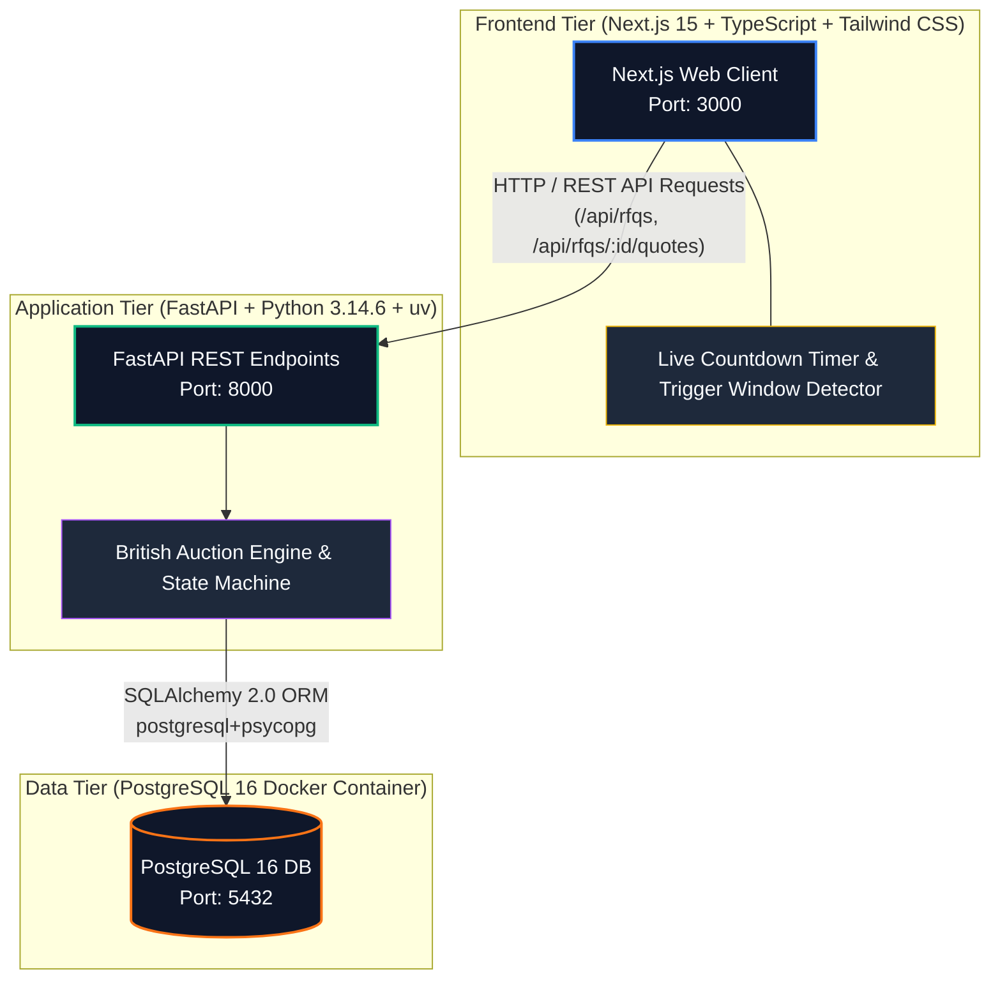
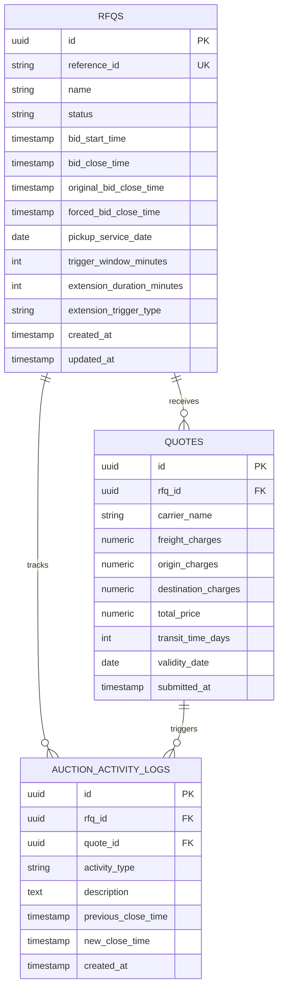

# British Auction in RFQ System

A production-grade, full-stack **Reverse Auction & RFQ (Request for Quotation) System** implementing **British Auction** mechanics:
- **Transparent Reverse Bidding:** Multiple suppliers openly submit competitive quotes with itemized charges (Freight, Origin, Destination) and compete by lowering prices ($L1, L2, L3\dots$).
- **Dynamic Bid-Time Auto-Extensions:** When competitive bidding occurs in the final **Trigger Window ($X$ minutes)** before close, the auction automatically extends by **$Y$ minutes**.
- **Hard Forced Close Ceiling:** Strict adherence to the rule that **the auction must never extend beyond the Forced Bid Close Time**—any extension that would surpass this hard cutoff is safely clamped or halted.
- **Configurable Auction Triggers:** Supports all 3 trigger modes specified in the requirements:
  1. `BID_RECEIVED`: Any bid placed in the last $X$ minutes triggers an extension.
  2. `ANY_RANK_CHANGE`: Any supplier rank shift in the last $X$ minutes triggers an extension.
  3. `L1_RANK_CHANGE`: Only an overtake of the lowest bidder ($L1$) in the last $X$ minutes triggers an extension.
- **Strict Network & Tier Isolation:** Monorepo architecture where the PostgreSQL database communicates **exclusively** with the FastAPI backend. The Next.js frontend interacts strictly via typed REST APIs.

---

## 1. High-Level Design (HLD) & Architecture Diagram



### Architectural Guardrails
1. **Database Isolation:** PostgreSQL is only accessible by the backend through `DATABASE_URL`. The frontend has zero database drivers or credentials.
2. **Atomic Extension State Machine:** When a quote is submitted, the backend atomically:
   - Validates that the auction is currently `ACTIVE` (now $\ge$ `bid_start_time` and now $<$ `bid_close_time`).
   - Checks if the submission timestamp falls within the Trigger Window $[T_{\text{close}} - X, T_{\text{close}}]$.
   - Compares previous vs. new supplier rankings to evaluate if the configured trigger rule is met.
   - Calculates $T_{\text{new}} = \min(T_{\text{close}} + Y, T_{\text{forced\_close}})$.
   - Updates `bid_close_time` and appends an immutable entry to `auction_activity_logs`.

---

## 2. Database Schema Design



### Table Specifications

#### 1. `rfqs`
| Column | Type | Constraints | Description |
|---|---|---|---|
| `id` | UUID | Primary Key | Unique internal identifier |
| `reference_id` | VARCHAR(50) | Unique, Indexed | Human-readable ID (e.g., `RFQ-2026-001`) |
| `name` | VARCHAR(255) | Not Null | RFQ title / freight route description |
| `status` | VARCHAR(20) | Not Null | `UPCOMING`, `ACTIVE`, `CLOSED`, or `FORCE_CLOSED` |
| `bid_start_time` | TIMESTAMPTZ | Not Null | When bidding opens |
| `bid_close_time` | TIMESTAMPTZ | Not Null | Dynamic closing deadline (extends when triggered) |
| `original_bid_close_time` | TIMESTAMPTZ | Not Null | Initial close deadline configured at creation |
| `forced_bid_close_time` | TIMESTAMPTZ | Not Null | Hard ceiling; extensions cannot exceed this deadline |
| `pickup_service_date` | DATE | Not Null | Target date for cargo pickup / service |
| `trigger_window_minutes` | INTEGER | Not Null ($X$) | E.g. 10 minutes before close |
| `extension_duration_minutes` | INTEGER | Not Null ($Y$) | E.g. 5 minutes added per extension |
| `extension_trigger_type` | VARCHAR(30) | Not Null | `BID_RECEIVED`, `ANY_RANK_CHANGE`, or `L1_RANK_CHANGE` |
| `created_at` / `updated_at` | TIMESTAMPTZ | Default now() | Audit timestamps |

#### 2. `quotes`
| Column | Type | Constraints | Description |
|---|---|---|---|
| `id` | UUID | Primary Key | Unique quote identifier |
| `rfq_id` | UUID | FK -> `rfqs.id` | Target RFQ |
| `carrier_name` | VARCHAR(150) | Not Null | Carrier / Supplier name |
| `freight_charges` | NUMERIC(12,2) | Not Null, $\ge 0$ | Freight linehaul cost (₹) |
| `origin_charges` | NUMERIC(12,2) | Not Null, $\ge 0$ | Terminal / pickup charges (₹) |
| `destination_charges` | NUMERIC(12,2) | Not Null, $\ge 0$ | Delivery / destination charges (₹) |
| `total_price` | NUMERIC(12,2) | Not Null, Indexed | Freight + Origin + Destination (₹) |
| `transit_time_days` | INTEGER | Not Null, $> 0$ | Estimated transit time in days |
| `validity_date` | DATE | Not Null | Quote expiration date |
| `submitted_at` | TIMESTAMPTZ | Default now() | Exact timestamp when quote was placed |

#### 3. `auction_activity_logs`
| Column | Type | Constraints | Description |
|---|---|---|---|
| `id` | UUID | Primary Key | Unique log entry ID |
| `rfq_id` | UUID | FK -> `rfqs.id` | Target RFQ |
| `quote_id` | UUID | FK -> `quotes.id`, Nullable | Linked quote (if triggered by a bid) |
| `activity_type` | VARCHAR(50) | Not Null | `RFQ_CREATED`, `BID_SUBMITTED`, `TIME_EXTENDED`, `STATUS_CHANGED` |
| `description` | TEXT | Not Null | Detailed explanation (e.g. extension rationale) |
| `previous_close_time` | TIMESTAMPTZ | Nullable | Close time prior to extension |
| `new_close_time` | TIMESTAMPTZ | Nullable | Close time after extension |
| `created_at` | TIMESTAMPTZ | Default now() | When the event occurred |

---

## 3. Monorepo Structure

```
Rfq/
├── docker-compose.yml              # PostgreSQL 16 Alpine container
├── pnpm-workspace.yaml             # pnpm workspace definition
├── package.json                    # Root scripts & Turborepo configuration
├── turbo.json                      # Turborepo task pipelines
├── apps/
│   ├── backend/                    # Python 3.14.6 + FastAPI + uv
│   │   ├── pyproject.toml          # uv package config & ruff linter settings
│   │   ├── package.json            # Workspace script hooks for Turborepo
│   │   ├── seed.py                 # Realistic India-centric demo data seeder
│   │   ├── main.py                 # FastAPI CLI entrypoint
│   │   ├── app/
│   │   │   ├── main.py             # FastAPI application instance & CORS
│   │   │   ├── config.py           # Environment variables (Pydantic Settings)
│   │   │   ├── database.py         # SQLAlchemy engine & session factory
│   │   │   ├── models/             # RFQ, Quote, AuctionActivityLog models
│   │   │   ├── schemas/            # Pydantic validation schemas
│   │   │   ├── services/           # British Auction state machine engine
│   │   │   └── api/                # REST endpoints (/rfqs, /quotes)
│   │   └── tests/                  # Pytest test suite (100% passing)
│   └── frontend/                   # Next.js 15 (App Router) + TypeScript + Tailwind
│       ├── package.json
│       ├── tailwind.config.ts      # Dark theme configuration
│       ├── src/
│       │   ├── app/
│       │   │   ├── page.tsx        # Auction Listing Overview (Status, L1, Timers)
│       │   │   ├── rfqs/new/       # RFQ Creation Form with British Auction rules
│       │   │   └── rfqs/[id]/      # Auction Details, Live Bidding, Leaderboard & Audit Log
│       │   ├── components/         # Timer, Leaderboard, Quote Breakdown, Modals
│       │   └── lib/                # Typed Fetch client & INR currency utilities
```

---

## 4. Quick Start: How to Run Locally

### Prerequisites
- **Node.js** (v18+) & **`pnpm`** (v9+)
- **Python** (3.14+) & **`uv`**
- **Docker** & **Docker Compose**

---

### Step 1: Start PostgreSQL Container
From the root directory:
```bash
pnpm docker:up
```
*(Or `docker compose up -d`). PostgreSQL 16 will start and run on `localhost:5432`.*

---

### Step 2: Seed India-Centric Demo Data
From the root directory:
```bash
pnpm backend:seed
```
*(Seeds 3 realistic auctions with Indian routes and Rupee quotes — including `RFQ-2026-001` closing in ~4 minutes within its trigger window).*

---

### Step 3: Run Both Backend & Frontend with a Single Command
From the root directory, simply run:
```bash
pnpm dev
```
Turborepo will automatically spin up both services concurrently:
- **Backend API:** [http://127.0.0.1:8000](http://127.0.0.1:8000)
- **Interactive Swagger Docs:** [http://127.0.0.1:8000/docs](http://127.0.0.1:8000/docs)
- **Frontend Web UI:** [http://localhost:3000](http://localhost:3000)

*(To stop the services, press `Ctrl+C`).*

---

### Alternative: Running Services Individually
If you prefer running services in separate terminals:
- **Backend only:** `pnpm dev:backend` (or `cd apps/backend && uv run fastapi dev`)
- **Frontend only:** `pnpm dev:frontend` (or `cd apps/frontend && pnpm dev`)

---

## 5. Running Automated Backend Tests

The British Auction state machine, validation rules, trigger logic, and forced-close capping are thoroughly tested:

```bash
pnpm backend:test
```
*(Or `cd apps/backend && uv run pytest`)*

To verify Ruff linting and formatting:
```bash
cd apps/backend
uv run ruff check .
uv run ruff format --check .
```
*(All checks pass with 0 errors).*

---

## 6. How to Test British Auction Features Manually

1. Open [http://localhost:3000](http://localhost:3000) in your browser.
2. Select **`RFQ-2026-001`** (Automotive Parts Freight: Chennai $\rightarrow$ Gurugram).
3. **Observe Live State:** Notice the yellow **`TRIGGER WINDOW ACTIVE`** banner because the auction has $< 10$ minutes remaining. Current $L1$ is `Delhivery Freight` at **₹43,500.00**.
4. **Trigger an Extension:**
   - Click **`Submit Supplier Quote`**.
   - Carrier: `Tata Motors Logistics`
   - Freight: `₹36,000`, Origin: `₹2,500`, Destination: `₹1,500` (Total: `₹40,000 < ₹43,500`).
   - Transit: `2` days.
   - Click **Submit Quote**.
   - **Result:** The modal alerts **`⚡ British Auction Extended!`**, the countdown timer jumps forward by **+5 minutes**, the Leaderboard updates Tata Motors Logistics to **L1**, and an audit trail entry is logged.
5. **Test Non-Qualifying Bid:**
   - Submit a bid higher than L1 (e.g., ₹45,000). The bid is saved, but the auction does **NOT** extend.
6. **Test Reviewer Testing Tool:**
   - Use the quick action buttons in the top toolbar (`Set 3 Mins Left`, `Set 1 Min Left`) to test window boundaries and forced close clamping on demand without waiting real hours.
