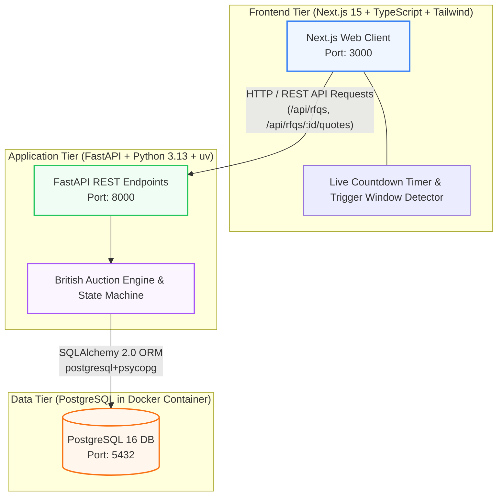

# British Auction in RFQ System

A streamlined, production-grade **Reverse Auction / RFQ (Request for Quotation) System** implementing **British Auction** mechanics:
- Open quote submission where suppliers compete to offer lower prices.
- **Dynamic Auto-Extension:** When bidding occurs in the final **Trigger Window ($X$ minutes)**, the auction deadline extends by **$Y$ minutes**.
- **Hard Forced Close Cap:** The auction strictly terminates at the **Forced Bid Close Time**—no extension may ever push the deadline past this hard ceiling.
- **Configurable Extension Rules:** Support for `BID_RECEIVED`, `ANY_RANK_CHANGE`, and `L1_RANK_CHANGE` triggers.
- **Strict Separation of Concerns:** Monorepo architecture where the database talks **exclusively** to the FastAPI backend, and the Next.js frontend interacts strictly via REST APIs.

---

## 1. High-Level Design (HLD) & Architecture



### Architectural Guardrails
1. **Zero Direct DB Access from Frontend:** The Next.js frontend has no database credentials or direct database drivers. All persistence is securely mediated by the FastAPI backend.
2. **Atomic Extension State Machine:** When a quote is submitted, the backend atomically:
   - Evaluates whether the submission is within the trigger window $[T_{\text{close}} - X, T_{\text{close}}]$.
   - Verifies whether the trigger condition (`BID_RECEIVED`, `ANY_RANK_CHANGE`, `L1_RANK_CHANGE`) is met.
   - Calculates $T_{\text{new}} = \min(T_{\text{close}} + Y, T_{\text{forced\_close}})$.
   - Persists the new deadline and creates an audit log entry detailing the reason.

---

## 2. Database Schema Design


### Tables Overview
- **`rfqs`**: Stores RFQ configuration including dynamic `bid_close_time`, hard ceiling `forced_bid_close_time`, window ($X$ min), extension ($Y$ min), and trigger rule.
- **`quotes`**: Stores supplier bids with transparent breakdown (`freight_charges`, `origin_charges`, `destination_charges`, `total_price`), transit time, and validity.
- **`auction_activity_logs`**: Complete audit trail recording bid submissions, state changes, and time extensions with human-readable rationale.

---

## 3. Tech Stack & Repository Structure

Built within a clean **Turborepo** monorepo using **pnpm**:

```
Rfq/
├── docker-compose.yml              # PostgreSQL 16 Alpine container
├── pnpm-workspace.yaml             # pnpm workspace config
├── package.json                    # Root scripts & Turbo build pipeline
├── turbo.json                      # Turborepo task definitions
├── apps/
│   ├── backend/                    # Python + FastAPI + uv
│   │   ├── pyproject.toml          # uv package config & pytest settings
│   │   ├── seed.py                 # Demo seeder with 3 realistic scenarios
│   │   ├── app/
│   │   │   ├── main.py             # FastAPI entrypoint & CORS
│   │   │   ├── config.py           # Pydantic Settings
│   │   │   ├── database.py         # SQLAlchemy engine & session maker
│   │   │   ├── models/             # RFQ, Quote, AuctionActivityLog models
│   │   │   ├── schemas/            # Pydantic validation schemas
│   │   │   ├── services/           # British Auction state machine engine
│   │   │   └── api/                # REST endpoints (/rfqs, /quotes)
│   │   └── tests/                  # Pytest test suite (all tests passing)
│   └── frontend/                   # Next.js 15 + TypeScript + Tailwind
│       ├── src/
│       │   ├── app/
│       │   │   ├── page.tsx        # Auction Listing Page (Status, L1, Timers)
│       │   │   ├── rfqs/new/       # RFQ Creation Form with British Auction rules
│       │   │   └── rfqs/[id]/      # Auction Details, Live Bidding, Leaderboard & Audit Log
│       │   ├── components/         # Timer, Leaderboard, Quote Breakdown, Forms
│       │   └── lib/                # Typed Fetch client
```

---

## 4. Quick Start Instructions

### Prerequisites
- Node.js (v18+) & `pnpm`
- Python 3.11+ & `uv`
- Docker & Docker Compose

### 1. Start the PostgreSQL Container
```bash
docker compose up -d
```
*PostgreSQL will be running and healthy on `localhost:5432`.*

### 2. Setup & Run the Backend (FastAPI + uv)
```bash
cd apps/backend
uv sync
uv run python seed.py     # Seeds realistic demo auctions
uv run uvicorn app.main:app --reload --port 8000
```
*API is live at [http://localhost:8000](http://localhost:8000) and Swagger docs at [http://localhost:8000/docs](http://localhost:8000/docs).*

### 3. Setup & Run the Frontend (Next.js + TypeScript + Tailwind)
In another terminal:
```bash
pnpm install
pnpm dev:frontend
```
*Open [http://localhost:3000](http://localhost:3000) to view the application.*

---

## 5. Running Automated Backend Tests

The British Auction engine is verified by comprehensive unit tests:
```bash
cd apps/backend
uv run pytest
```
*Verifies creation validations, trigger window detection, all 3 trigger rules, and forced close capping.*

---

## 6. How to Test the British Auction Features

When you load the frontend at `http://localhost:3000`, the seeded auction **RFQ-2026-001** is configured to close in **~3 minutes** (inside its 10-minute trigger window):
1. Click **View Auction & Bid** on **RFQ-2026-001**.
2. Notice the yellow **TRIGGER WINDOW ACTIVE** indicator.
3. Click **Submit Supplier Quote** and enter a quote lower than the current L1 (\$4,150.00), e.g., \$3,800.00.
4. **Result:** The auction deadline immediately extends by **5 minutes**! An audit log is instantly recorded with the exact reason.
5. You can also use the built-in **Reviewer Testing Tool** bar on the auction page to shift the close time to 3 mins or 1 min left for easy on-demand demonstration.
